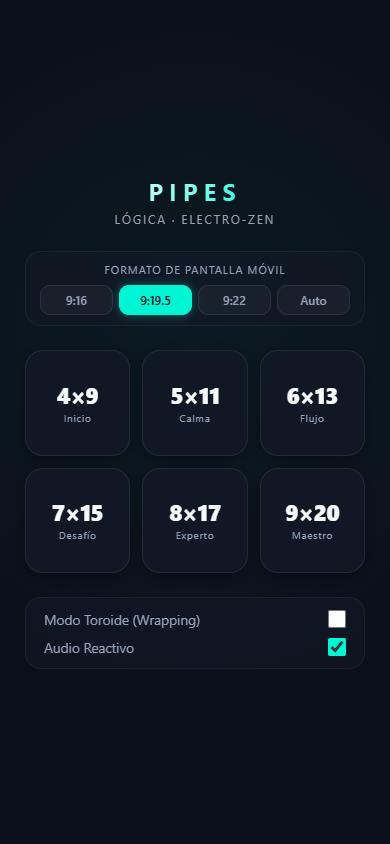
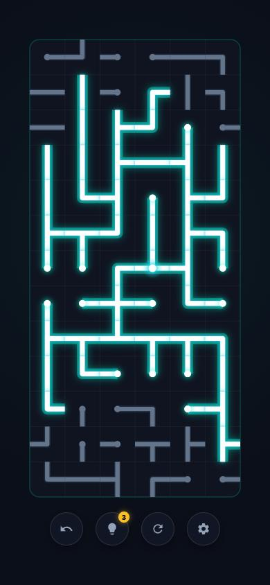
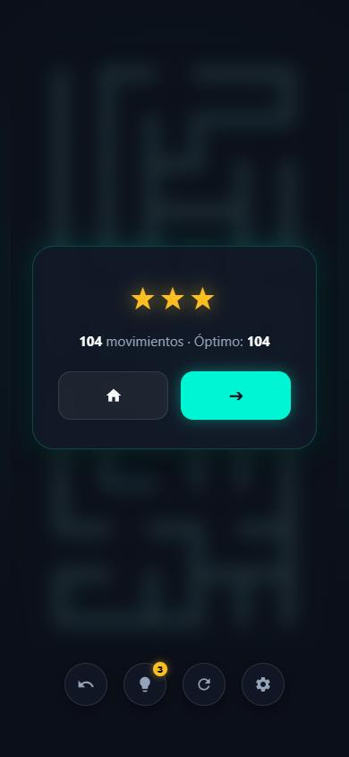

# Pipes

**Puzzle de tuberías, minimalista.** Girás las piezas hasta conectar todo el circuito con la fuente de energía. Sin
texto durante la partida y con tableros pensados para pantallas de celular alargadas.

  
  
  

## Cómo

1. Elegí un tablero (de 4×9 a 9×20) y, si querés, el modo toroide, donde los bordes se conectan entre sí.
2. Tocá una pieza para girarla. La energía se propaga en vivo desde la fuente.
3. Ganás al energizar todo el circuito sin fugas. Hay deshacer y tres pistas.

**[Jugar online](https://nullpointlol.github.io/pipes/web/)**, o abrir [`web/index.html`](web/index.html) en
cualquier navegador. También hay versión Android nativa
(Kotlin y Jetpack Compose). Cómo compilarla y detalles técnicos en [docs/desarrollo.md](docs/desarrollo.md).
Licencia [MIT](LICENSE).
